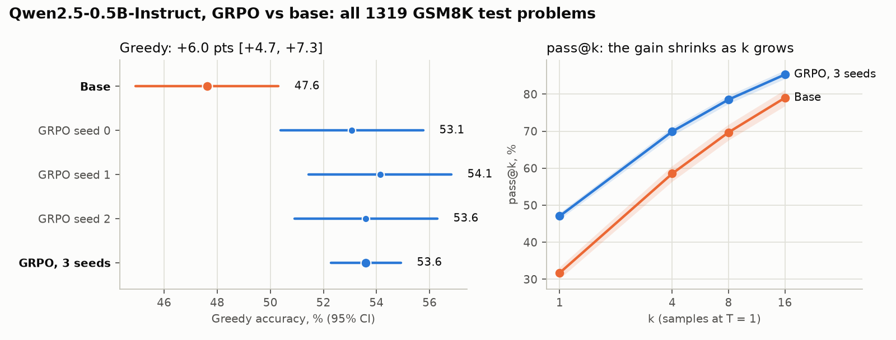

# grpo-lab

From-scratch GRPO-style RL post-training for small language models, plus a dashboard for
looking inside training: **[grpo-lab-seven.vercel.app](https://grpo-lab-seven.vercel.app)**
(recorded runs; no GPU or server behind it). See [SPEC.md](SPEC.md) for the research questions, scope and milestones.

**Status:** MVP done (M0–M4: scaffold, algorithm core, first GSM8K run, eval harness, dashboard).
M7 (RQ1 ablations) has its first sweep: two seeds each of Dr. GRPO and DAPO-lite, below. Next: a
third seed of each, DAPO's dynamic sampling, and M5 (parity with TRL's `GRPOTrainer`); see
[SPEC.md](SPEC.md) §6.

## Result



GRPO on Qwen2.5-0.5B-Instruct (300 steps, G=8, β=0.04, one A40, ~2 h per seed) raises greedy accuracy on
all 1319 GSM8K test problems from **47.6% to 53.6%**: **+6.0 pts, 95% CI [+4.7, +7.3]** across 3
seeds. The base and trained CIs don't overlap, and each seed beats base on its own (paired McNemar
p ≤ 1.1e-05).

- The gain is largest at pass@1 (+15.3 pts) and shrinks as k grows (+6.3 at pass@16). Most of what
  GRPO does here is sharpen the policy toward answers the base model can already sample, rather
  than teach it to solve problems it never solved. That fits what others report for RL on small
  models.
- Rebuild the figure from the committed comparison:
  `uv run --group report python scripts/report_figures.py`.

### M7: does the recipe matter at 0.5B?

Two published variants against the vanilla GRPO above, each trained 300 steps with the same
config apart from the overrides shown (`scripts/m7_run.sh`), and scored the same way: the final
checkpoint, greedy, on all 1319 test problems.

| Variant | Overrides | Seeds (greedy %) | Mean | vs base | vs vanilla, Welch 95% CI | Entropy | Length |
|---|---|---|---|---|---|---|---|
| Vanilla GRPO (M3) | none | 53.1, 54.1, 53.6 | 53.6 | +6.0 | (baseline) | 0.203 | 291 |
| Dr. GRPO | `advantage_scale=none`, `loss_aggregation=constant` | 53.0, 52.5 | 52.7 | +5.1 | −0.9 [−2.6, +0.9] | 0.233 | 294 |
| DAPO-lite | `loss_aggregation=token_mean`, `clip_eps_high=0.28`, `beta=0` | 55.3, 54.4 | 54.8 | +7.2 | +1.2 [−5.8, +8.2] | 0.100 | 249 |

Entropy and length are means over each run's last 20 training steps. With two seeds per variant
neither accuracy gap is distinguishable from zero. The training behaviour is: DAPO-lite halves
the policy's entropy and writes answers about 15% shorter, and 46% of its groups end with all eight
samples agreeing (31% for vanilla), so close to half its batches carry no learning signal. That
is the problem DAPO's dynamic sampling exists to fix, and "lite" leaves it out. Comparisons are
in `report/m7-drgrpo.json` and `report/m7-dapo-lite.json` (`evaluate compare --json`). The four
runs cost $5.87 of GPU.

## Layout

| Path | What |
|---|---|
| `runstore/` | On-disk run store (SQLite + Parquet): the only contract between trainer and API |
| `trainer/` | `grpo_lab`: rollouts, rewards, advantages, loss, training loop (PyTorch) |
| `api/` | Read-only FastAPI over the run store (no torch dependency) |
| `web/` | Next.js + shadcn/ui dashboard: runs, metric curves, rollout inspector (static site) |

## Quickstart

```bash
uv sync --all-packages
uv run pytest                                              # 80 tests incl. 3 end-to-end learning runs
uv run train --config trainer/configs/toy.yaml             # tiny random model learns a target token (CPU, seconds)
uv run train --config trainer/configs/smoke_gsm8k.yaml     # Qwen2.5-0.5B on GSM8K, 3 steps (MPS/CUDA, ~1 GB download)
GRPO_STORE=runs uv run uvicorn grpo_api.main:app --reload  # API on :8000
uv run export-static && cd web && pnpm dev                 # dashboard on :3000 (see Dashboard)
```

Override any config value from the CLI, e.g. for ablations:

```bash
uv run train --config trainer/configs/toy.yaml --override algo.beta=0.0 --override algo.loss_aggregation=token_mean
```

## Running on a GPU (M2): RunPod

**Pod:** one 48 GB card (A40, L40S or RTX A6000), on-demand, not spot: runs don't resume from
checkpoints yet. Estimated peak memory is ~20–25 GB (the pilot measures it), and a 0.5B model
under HF `generate` is limited by per-token latency, not FLOPs, so an A100/H100 costs 2–4x more
for little speedup. A 24 GB card (RTX 4090, L4) is the cheapest option if you add
`--override train.micro_batch_size=4`. Any recent "RunPod PyTorch" template works (uv installs
its own torch; the template only needs to supply the NVIDIA driver). **Filter hosts by CUDA
version ≥ 13.0** when deploying: `uv.lock` pins a CUDA 13 torch build, which needs driver ≥ 580,
and on older hosts `torch.cuda.is_available()` is False (`gpu_setup.sh` fails fast if so). Container disk 20 GB, **volume disk 50 GB at `/workspace`**
(the only path that survives a pod stop), and tick **SSH terminal access** / expose TCP port 22.
Add your SSH public key under RunPod account settings first.

Use the pod's **"SSH over exposed TCP"** command (`ssh root@<ip> -p <port>`), not the
`ssh.runpod.io` proxy: the proxy doesn't support rsync or scp.

```bash
# 1. on the pod: clone into the persistent volume. A clone (not a file copy) means every run
#    records the exact commit it ran (runs.git_sha). Commit and push before launching.
cd /workspace && git clone https://github.com/Padraigobrien08/grpo-lab.git  # add -b <branch>
# 2. on the pod: tmux, rsync, uv, caches on /workspace, CUDA check, model + data, tests
cd /workspace/grpo-lab && bash scripts/gpu_setup.sh && source ~/.bashrc
# 3. pilot (20 steps): check memory/peak_gb, time per step, adv/zero_group_frac
#    PYTHONUNBUFFERED=1: piped into tee, Python block-buffers stdout and the log looks frozen.
tmux new -s pilot 'PYTHONUNBUFFERED=1 uv run train --config trainer/configs/gsm8k_grpo.yaml \
  --override train.steps=20 --override eval.every=20 --override name=gsm8k-pilot 2>&1 | tee pilot.log'
# 4. full run (~2.5 h on an A40). Stops the pod when training ends, crash or not, so an overnight
#    run doesn't bill idle GPU hours. Detach with Ctrl-b d; reattach with: tmux attach -t train
#    RUNPOD_POD_ID/RUNPOD_API_KEY live in /etc/rp_environment, which non-interactive shells skip.
#    Verified on 2026-11-24: the stop worked with the pod's own key (train.log ends with
#    `pod "<id>" stopped`), even though `runpodctl get pod` answered Unauthorized with it.
tmux new -s train 'source /etc/rp_environment; PYTHONUNBUFFERED=1 uv run train \
  --config trainer/configs/gsm8k_grpo.yaml 2>&1 | tee train.log; runpodctl stop pod $RUNPOD_POD_ID'
# 5. pull results back (from your machine). Replaces your local runs/store.sqlite.
rsync -az -e 'ssh -p <port>' root@<ip>:/workspace/grpo-lab/runs/ runs/
```

**Cost controls.**
- RunPod is prepaid: load only what you're willing to spend (e.g. $20). That's a hard cap.
- Pilot before the full run. It takes ~15 minutes, and a bad config shows up in the first few
  steps (OOM, zero-advantage fraction near 1, eval accuracy falling).
- Stop the pod whenever you're not using it. A stopped pod bills only for the volume (pennies
  per day), and `/workspace` (code, venv, caches, runs, checkpoints) is kept. After a restart,
  rerun step 2 (seconds: everything is cached); `<ip>`/`<port>` may change. If the host's GPUs
  are taken when you restart, you may have to wait for one, or start without a GPU just to pull
  results.
- Terminate the pod (which deletes the volume) once results and any checkpoints you need are
  pulled back.
- Kill a run early if `eval/accuracy` is flat or falling after ~100 steps.

Watch the `eval @ step` lines: greedy accuracy on a fixed 500-problem GSM8K test subset, scored
before step 1 (the base model) and every 25 steps. That, not training reward, is the M2 signal.
The final policy is saved to `checkpoints/<run_id>/` for M3's eval.

## Evaluating (M3)

`uv run evaluate` scores a model on all 1319 GSM8K test problems and compares models with 95% CIs.
It uses the training config for prompts, stop tokens, max length, temperature and autocast, so a
model is scored the same way it was trained.

```bash
uv run evaluate run --model Qwen/Qwen2.5-0.5B-Instruct --label base   # greedy + pass@1/4/8/16
uv run evaluate run --model checkpoints/<run_id>                        # one per training seed
uv run evaluate compare evals/base evals/<run_a> evals/<run_b> evals/<run_c> \
  --json report/gsm8k-3seed.json     # committed; the README figure is drawn from it
```

- **Greedy accuracy** is the headline. **pass@k** uses the unbiased estimator over `--samples`
  draws at the training temperature (default 16; `--samples 0` for greedy only).
- **Score the final checkpoint**, not the step with the best eval curve: that curve is on the
  test set, so picking a step by it inflates the result.
- **`compare`** pairs base and trained on the same problems (paired CI, exact McNemar test), and
  with two or more trained runs adds mean ± Student-t 95% CI across seeds.
- Output goes to `evals/<label>/`: `problems.parquet` (one row per problem, greedy text
  included) and `summary.json`.
- Cost: greedy takes ~2 min per model on an A40 and ~15 min on an M-series Mac. pass@16 is
  ~21k completions per model (~30 min on an A40), so run it on the GPU.

## Dashboard (M4)

Four views over the run store: **Runs** (final metrics and the config keys that differ between
runs), **Run detail** (metric curves with EMA smoothing; click a chart to open the rollouts logged
nearest that step), the **Rollout inspector** (pick a logged step and a prompt to see all G
samples with their rewards, advantages, lengths and boxed answers) and **Compare** (runs grouped
by training config, seeds pooled: a mean curve with a 95% t-band per group, labelled by what each
group changes relative to the baseline, the group with the most runs).

**Token heatmap.** On every rollout-logging step the trainer also records per-token traces for
the first `log.trace_groups` groups (default 2; `0` turns it off). For those groups, marked
"tokens" in the inspector's prompt list, the completions can be coloured by **surprisal**
(−log p under the sampling policy), **entropy**, **KL** to the reference, or the **ratio**
π/π_old. One scale is shared across the group so siblings compare token by token; hover a token
for all its values. The values are copied from tensors the update already computes, so tracing
adds no forward passes. On GSM8K it adds 5–9 MB of snapshot JSON per 300-step run (measured on
the four M7 runs; shorter answers make smaller traces).
Ratio is exactly 1 when `algo.num_iterations` is 1, and KL is absent when `algo.beta` is 0, so
the inspector disables those views.

It's a static Next.js site (`output: "export"`) that fetches JSON in the browser, from one of two
sources behind the same paths:

```bash
# A snapshot: every API response written to web/public/data/<path>.json (gitignored).
uv run export-static                  # reads runs/ (or $GRPO_STORE)
cd web && pnpm dev                    # http://localhost:3000
# Or the live API, e.g. while a run is training:
uv run uvicorn grpo_api.main:app --port 8000
cd web && NEXT_PUBLIC_API_URL=http://localhost:8000 pnpm dev
```

`pnpm build` writes the deployable site to `web/out/`, including the snapshot; it needs no server
and no GPU. Re-run `export-static` before building to include new runs.

**Deploying:** `bash scripts/deploy_dashboard.sh` snapshots, builds and uploads `web/out/` to Vercel
(`--preview` for a preview URL). It deploys the prebuilt directory, not from git, because the
snapshot comes from your local `runs/`, which isn't committed. Run `npx vercel@65.14.0 login` once
first. The root `vercel.json` turns off git-triggered deploys: the Vercel project is connected to
this repo, and a git build would auto-detect the FastAPI app and replace the dashboard with an
API that has no runs.

- Pages take the run as a query param (`/run?id=…`, `/rollouts?id=…&step=…&prompt=…&tokens=…`), not a
  `[id]` route: a static export needs every dynamic route known at build time, which would tie
  the pages to one snapshot.
- Runs trained on different machines end up in different stores. Fold one into another with
  `uv run runstore merge <src> <dst>` (it refuses run-id clashes and writes nothing if it does).
- Not yet: following one prompt across steps (training prompts don't repeat between logged
  steps). Runs trained before token traces existed (the M2/M3 runs) have no heatmap.

## What went wrong along the way

Algorithm and training:
- **The GSM8K `#### <n>` answer format starved the gradient.** Probing the base model before
  renting a GPU, it scored ~2% greedy (6% at T=1) with that prompt, against ~44% with Qwen's own
  `\boxed{}` math prompt. At 6%, about 60% of G=8 groups would get all-zero reward, which means
  zero advantage and no gradient. The fix was to switch the prompt and verifier to `\boxed{}`, with
  credit only when the box holds exactly one number. `adv/zero_group_frac` is logged every step
  for this reason.
- **bf16 weights silently froze training.** At lr=1e-6, AdamW updates to bf16 weights round to
  zero. The fix keeps fp32 master weights with bf16 autocast; the config now rejects bf16
  weights.
- **No warmup collapsed the model in one step.** On the smoke config, Adam's first full-size step
  pushed Qwen2.5-0.5B onto the format reward in one update. The fix was LR warmup (10 steps in the
  GSM8K config).

GPU runs on RunPod:
- **No CUDA on some hosts.** The locked torch build needs CUDA ≥ 13 (driver ≥ 580). On older
  hosts `torch.cuda.is_available()` is False, so `gpu_setup.sh` now fails fast.
- **Frozen-looking logs.** Piped into `tee`, Python block-buffers stdout, so the tmux log sat
  still for minutes. The fix is `PYTHONUNBUFFERED=1`.
- **The pod didn't stop itself.** `RUNPOD_POD_ID` is only exported in `/etc/rp_environment`,
  which non-interactive shells skip, so `runpodctl stop pod $RUNPOD_POD_ID` ran with an empty id.
  The fix sources that file first, and it's now verified to stop the pod after a run.
- **Runs need provenance.** A file copy onto the pod has no git history, so a run couldn't record
  its commit. The pod now clones the repo, and every run records `git_sha`. Also, the `ssh.runpod.io` proxy can't rsync, so use the
  pod's exposed TCP port.

Known limitations:
- The in-training `eval/accuracy` curve uses a 500-problem slice of the **test** set. It's a
  progress signal only. The headline numbers score the final checkpoint on the full test set,
  never a step picked from that curve.
- No parity check against a reference implementation yet (M5). Correctness rests on the unit
  tests below and the learning result above.

## What the tests pin down

- **Loss:** on-policy gradient = −advantage; all four clipping cases; DAPO clip-higher;
  masked tokens are ignored; per-token weights for each aggregation (GRPO / DAPO / Dr. GRPO);
  micro-batch losses sum exactly to the full-batch loss.
- **Log-probs:** match a manual log-softmax; unaffected by left padding; **equal to the distribution
  `generate()` actually sampled from** (temperature included).
- **KL:** k1/k3 estimators match the exact KL in expectation; k3 has lower variance.
- **End-to-end:** the full loop raises reward from chance (~0.06) to >0.8 on the toy task, for
  vanilla GRPO and a Dr. GRPO/DAPO-style variant with μ=2.
